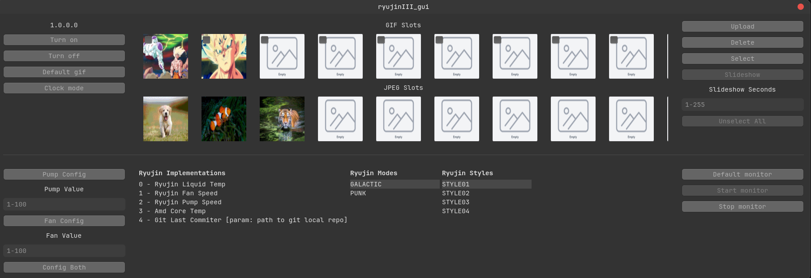

# Ryujin III GUI Control Software

GUI Software to help you control your Asus Ryujin III Water Cooling under linux. Right now I only support Debian 13 (And
probably some Debian base distros).

Based from command only binary: https://github.com/iscluis06/ryujin_III_software_control

If you find this useful, please consider making a donation. Thanks!<br><br>
[](https://www.buymeacoffee.com/iscluis06)

### Requirements

* Debian 13 (It may also work on some debian based distros)
* libusb 1.0 (shared library)
* libudev (shared library)
* imagemagick (needed to prepare gifs)

Use the following to install the required dependencies.

```shell
apt install libusb-1.0-0 libusb-1.0-0-dev libmagick++-7-headers imagemagick
```


